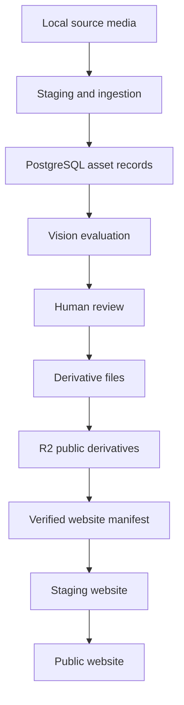

# Pipeline and storage audit

## Scope and evidence

Remote AIR `e1f716953c8daae8399fda7635ba78ca0ea970c9`; remote public website `334a3ad245b9dc4408b96c4188a56a407359c06a`; staging `8e7e2325fdb6ea7d360952e4f6c93c6c2804045c`, whose initial commit has an empty tree. Local AIR `0be9e8b` differs substantially from GitHub. Local public website `22cc6a1` includes pre-existing uncommitted changes, preserved throughout this work.

Forty of 43 inspected website component/route/style/package files match current remote blob hashes. Differences are package.json, site-footer.tsx and the locally edited drone.tsx. Source recommendations concerning those three files are local-checkout observations, not assertions about the exact deployed bundle. The live site reports `src-8e7ee19 · 2026-10-26`.

## What exists

The arrows from review to derivatives and derivatives to R2 were incomplete in inspected upstream code. This work adds an explicit bounded derivative job and a dry-run-first uploader, but database execution and cloud upload remain unverified. Video, 3D and tours do not yet have a complete publication contract.

Neon is the intended hosted PostgreSQL provider, based on the Spark worker and owner clarification. Docker also defines a local PostgreSQL service. The API uses DATABASE_URL; Spark uses NEON_DATABASE_URL. The connected `baronaerial-site` project (`aged-field-81963191`, main `br-cold-moon-b89uylat`) has `_migrations` and `mission_briefs` in `neondb`, not the pipeline asset schema. That proves website storage is present, not that the pipeline database has been found. No hosted data was changed. Supabase migration is not proposed.

R2 is object/file storage, not the relational database. Use PostgreSQL for assets, evaluations, review events, jobs and publication records; use R2 for bytes, with hashes and object keys stored in PostgreSQL. Keep private originals and review proxies separate from public derivatives.

## Prioritized problem register

| ID | Priority | Evidence / defect | Solution and acceptance test | Status |
|---|---|---|---|---|
| P01 | Critical | Compose clears OLLAMA_URL and forces Azure despite local defaults in env.example | Respect explicit backend and URL; boot without paid-provider keys | Patched; runtime blocked |
| P02 | Critical | derivative_builder.js defines a function but has no dispatcher | Bounded restartable batch with source hashes and DB row locking; approve one still then verify copies | Implemented; actual file generation tested, DB path blocked |
| P03 | Critical | spark_worker.py creates an incompatible table named assets | Retire Spark schema or migrate into a separate schema; fail on incompatible schema version; do not run both init scripts | Open |
| P04 | Critical | Main/review APIs have no authentication or authorization; Compose originally published DB/API ports on all interfaces | Loopback bound now; add reviewer identity, project permissions, CSRF/origin protection and authenticated WebSockets before any remote review connection | Network default fixed; auth open |
| P05 | High | Existing approve endpoint permits state changes without rights, reviewer ID or validated metadata; decision log omitted when no edits/notes | Transactional state machine, always record actor/time/revision; require rights and valid alt/tags | Open |
| P06 | High | `_run_script` reports success even when subprocess exits nonzero | Return failure HTTP status; test nonzero child plus timeout, disconnect and cancellation | Nonzero handling patched; lifecycle tests pending |
| P07 | High | Review list/detail/overview repeatedly fetch entire dataset and run grouping in Python | SQL filters/keyset pagination, server aggregates, selective columns; benchmark 10k assets and query count | Open |
| P08 | High | Model responses checked only as nonempty objects; score handling weak | Per-stage schemas, enum/range validation, raw response evidence, model/version/config identity, bounded retries and failed state | Score validation added; full schemas open |
| P09 | High | Vision worker may feed video/model binaries as images; no frame-to-parent lineage | Separate image/video/model adapters; sampled frames with timestamps, model preview renders and provenance | Stills-only selection now; other paths explicitly blocked |
| P10 | High | GPS altitude used to force aerial perspective; altitude datum unknown | Keep GPS/relative altitude/datum separate; classify using geometry and pitch, allow unknown | Prompt corrected; telemetry model still needs migration |
| P11 | High | Ingest ExifTool lacked numeric output and timeout; missing location became zero and missing capture time became ingestion time | Numeric EXIF, timeout, nullable unknowns, normalized dates; test true source metadata | Patched; source EXIF test blocked by missing host tool |
| P12 | High | Review media endpoint accepts image/video only and returns 415 for model formats | GLB and tour-specific viewers; safe texture dependency resolution and range requests; real fixtures | Open |
| P13 | High | Export supports still WebP only | Preserve strict v1; design versioned video/model/tour contracts with duration, codec, poster, bounds, resources, projection | Open; do not weaken v1 validation |
| P14 | High | Staging repository is empty | Seed from tracked public source; separate secrets, database branch and media domain; CI promotion of exact artifact | Bootstrap helper written; clone/runtime blocked |
| P15 | High | Original eight-hex-character stem has only 32 bits and is UNIQUE | Full hash identity plus separately allocated display code; handle collision/reingest transactionally | Open |
| P16 | Medium | Preprocessor permits output beneath source and width-only resizing | Reject recursive output; constrain both dimensions | Fixed; regression tests pass |
| P17 | Medium | Requirements unpinned; Node worker has no lockfile; CI lacks database env for import-time access | Lock validated dependency versions; add reproducible container CI and service-backed tests | Import-time failure/CI env fixed; lockfiles open |
| P18 | Medium | Redis pub/sub is notification delivery, not a durable queue; handles created repeatedly | Managed lifespan connections, bounded history, durable job table/queue with leases and retries | Open |
| P19 | Medium | Legacy manifest uses default credential-bearing DSN and can expose coordinates | Remove embedded default; use strict website exporter for public output; inspect historical secret exposure | Default removed; rotate only if ever real |
| P20 | Medium | Docs claim no tests despite a tests directory; root/local/remote layouts differ | One canonical startup document, explicit revision inventory and migration notes | Integration docs added; old README wording remains |

## Storage improvements

Use immutable original hashes and never replace source files during corrections. Store capture time, ingest time and modification time separately. Make every derivative reference parent hash, transform version, dimensions, MIME and byte hash. Generated keys should include output content hashes. Keep review proxies temporary with lifecycle expiry; retain originals according to client retention requirements, not a blanket deletion policy.

Publication needs a separate record containing manifest hash, reviewer, rights scope, environment, remote verification timestamp and release revision. Mark an upload successful only after remote bytes match expected hashes. R2 ETag is not a general substitute for SHA-256, particularly for multipart objects. Retain a prior manifest for rollback; switching a release should not delete prior objects.

Use one canonical pipeline schema. Avoid silently falling back from a failed production database to an older SQLite snapshot: snapshots should be an explicitly selected offline review mode with an age banner. Website mission briefs are a different domain and should use separate roles/schema or database. Do not share a privileged media-worker role with the public website.

Useful schema additions: processing_jobs with lease owner/expiry/attempt count; source_files; asset_relations (frame/model texture/tour scene); evaluation runs with provider/model/prompt/schema version; review events with optimistic revision; publication releases. Add indexes only after explaining the real queries. Start with `(workflow_state, created_at)` and `(asset_id, evaluated_at DESC)` candidates and measure.

## Efficiency recommendations

Avoid three model passes for every near-duplicate photo. First deduplicate by SHA, group bursts/time/geography with evidence, compute cheap blur/exposure checks, and select representative frames. Use one configured vision model for first pass; escalate uncertain/disputed results. A judge comparing two answers is not independent ground truth. Cache evaluation by source/proxy hash plus model/prompt/schema version, not filename.

Keep GPU/FFmpeg/photogrammetry on the NAS or workstation. Replit should provide the authenticated review experience and reach a deliberately secured backend; it should not receive database superuser or R2 write credentials in client code. Cloudflare can deliver approved derivatives and protect the API boundary without being forced to run long photogrammetry jobs.

## Validation evidence

AIR tests: 32 pass. Integration helpers: 4 pass. Existing public-site suites: 154 script plus 38 TypeScript tests pass; typecheck and production build pass. Compose configuration, Python compilation, Node and shell syntax checks pass. These are not a full end-to-end acceptance result.

A real local property detail JPEG generated 400x230, 800x460, 1400x805 and 1408x810 WebP files. Re-running produced identical metadata and bytes. An unapproved state and incorrect source hash were rejected. Strict export and public-site importer dry-run accepted the test data. Approval in that fixture is test-only, not authorization to publish the image.

`overpass.mp4` (7.465792 seconds) yielded three JPEG keyframes. Model analysis, aggregation, video delivery and playback of pipeline-generated output were not exercised. No 3D/tour source asset was found. Existing grouping tests cover model-related grouping logic, not actual geometry rendering or reconstruction.

Docker socket access denied; shell GitHub DNS failed; ExifTool absent on host. API image builds, DB transactions, real inference, R2 round-trip and live integrated review remain blocked. Do not substitute green unit tests for these checks.

References: https://developers.cloudflare.com/r2/ ; https://openrouter.ai/docs/guides/routing/model-variants/free ; repository source paths above. Recommendations are proposed architecture, not claims of deployed behavior.
